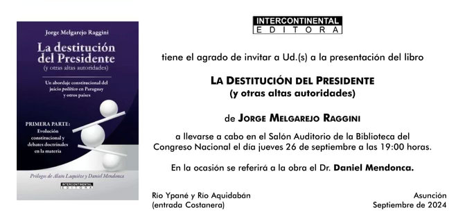

**El jueves 26 de setiembre -a las 19:00 hs- en el Salón Auditorio de la Biblioteca del Congreso Nacional**, **Jorge Melgarejo Raggini**, miembro del IPDC, presentará el libro _La destitución del Presidente (y otras altas autoridades). Un abordaje constitucional del juicio político en Paraguay y otros países_. El profesor **Daniel Mendonca**, reconocido constitucionalista y miembro fundador del IPDC, será el encargado de referirse la obra.   

​El trabajo de investigación aborda de manera exhaustiva la destitución del Jefe de Estado, particularmente en el denominado sistema presidencial y tomando como principal ejemplo el caso paraguayo. Haciendo una retrospectiva histórica, la idea de exigir la responsabilidad constitucional del Presidente era un objetivo poco realista, que solo podía ser posible desde una hipótesis lejana. Con la entrada en vigencia de la Constitución de 1992, cuyos redactores han robustecido las facultades del Congresobuscando un reequilibrio entre los poderes, se ha percibido una tendencia en el régimen paraguayo: el Presidente de la República, así como otras altas autoridades, han tenido que hacer frente constantemente a la amenaza del llamado “juicio político”.Un mecanismo concebido en principio para una utilización excepcional que, con el tiempo, ha sufrido los efectos de la banalización. Así, la forma de comprender el procedimiento ha legitimado un modus operandi por el cual la permanencia del Presidente o de otras autoridades depende, en la práctica, de una cuestión de “confianza parlamentaria”, algo que no parece propio de un sistema presidencial.

La destitución del Jefe de Estado es un asunto que llama al derecho constitucional desde un enfoque pluralista. El trabajo, bajo el sello de _Intercontinental Editora_ y que ha sido prologado por los profesores Alain Laquièze y Daniel Mendonca, se divide en dos tomos. En la primera parte, se examinan la evolución constitucional y los debates doctrinales en torno a la materia. Se consideran los elementos teóricos que desde la doctrina constitucional se han instituido con relación al juicio político, modelo parlamentario de destitución que tiene su fuente de inspiración en el _impeachment_ de la Constitución de los Estados Unidos. En la segunda parte, el autor toma muy en cuenta la dimensión de la práctica de los actores-intérpretes, a través de los diversos casos de utilización del mecanismo con relación al Presidente, y adicionalmente con otras altas autoridades. Igualmente, a fin de tener una perspectiva más amplia del tema, Jorge Melgarejo propone un análisis histórico y comparado de la destitución del Presidente, profundizando en países como Estados Unidos, Argentina, Brasil, así como Francia, entre otros.

Los dos tomos han sido fruto de más de cuatro años de investigación, en el marco del Programa de Doctorado en derecho público que ha realizado el autor en la Universidad _Paris Cité_ (Francia), con el apoyo de BECAL. El objetivo es contribuir al debate y a la reflexión sobre este tema tan relevante para el derecho constitucional.

